# Modelagem de Banco de Dados para Gestão de Informações da Ansarah
Projeto acadêmico de modelagem de Banco de Dados da empresa ANSARAH - UNICID

## Integrantes
- **Ana Beatriz Mendes Gonçalves**
- **Luiz Gustavo Santos de Oliveira**
- **Samantha Paula dos Santos Silva**

## 1. Introdução

Este trabalho apresenta a modelagem conceitual de um sistema de gestão de informações para a Ansarah, organização que atua no comércio de roupas de academia, roupas íntimas e produtos relacionados ao segmento de moda.
</br></br>
O trabalho tem como objetivo desenvolver um modelo conceitual de dados que represente as principais informações e processos da organização, contribuindo para uma melhor organização e gerenciamento dos dados utilizados em suas atividades. O levantamento de requisitos foi realizado por meio de pesquisa de campo, utilizando um questionário com perguntas direcionadas à organização. As informações foram obtidas por meio de entrevista com Alessandra, uma das proprietárias da Ansarah e responsável pela administração do setor financeiro, sendo utilizadas como base para a compreensão dos processos, informações, dificuldades e regras de funcionamento da organização.
</br></br>
O projeto tem como delimitação a modelagem conceitual das informações e dos processos levantados junto à organização, não abrangendo, nesta etapa, a implementação do banco de dados ou o desenvolvimento do sistema. O modelo será construído com base nos processos e nas necessidades identificadas durante o levantamento de requisitos.


---

## 2. Caracterização da Organização

**Nome e natureza da organização:** A Ansarah é uma empresa comercial, pertencente ao segmento de moda e vestuário. Sua história começou em 1932, na Rua 25 de Março, em São Paulo, inicialmente com a comercialização de meias. Ao longo dos anos, a empresa expandiu sua atuação para moda íntima, lingerie e outros tipos de vestuário, comercializando atualmente diversos produtos por meio de lojas físicas e loja virtual. 
</br></br>
**Contexto e porte:** A Ansarah é uma empresa com fins lucrativos, com uma operação consolidada no segmento de moda e vestuário. Possui entre 50 e 100 funcionários, loja física, loja virtual e centro de logística, realizando vendas no varejo e no atacado para todo o país.
</br></br>
**Problemas e necessidades identificados:** Os principais problemas identificados estão relacionados à inserção manual das informações no sistema, especialmente no cadastro de produtos, à dificuldade de criação de relatórios personalizados e à recuperação das informações após a perda ou restauração de um backup. Nesses casos, é necessário retornar a um backup anterior e realizar novamente, de forma manual, a inserção das informações que não estavam presentes na versão recuperada, o que pode gerar retrabalho e aumentar o risco de perda ou desatualização dos dados. Dessa forma, identifica-se a necessidade de otimizar a inserção e atualização das informações no sistema, facilitar a obtenção de informações para apoio à tomada de decisão e melhorar os mecanismos relacionados à recuperação dos dados. 
</br></br>
**Justificativa da escolha:** a Ansarah foi escolhida porque o grupo possui acesso à organização por meio de contato com seu responsável. Uma das integrantes do grupo possui vínculo familiar com uma funcionária da empresa, o que possibilitou o contato e a realização da pesquisa de campo. Além disso, a organização possui diversos processos de negócio adequados à aplicação dos conceitos de banco de dados.
</br></br>

---

## 3. Evidências da Pesquisa
<br>
Para comprovar a existência da organização e o acesso do grupo para a realização da pesquisa de campo, foram reunidas informações e registros relacionados à Ansarah.

### 3.1 Fotos das lojas

- **Loja da 25 de Março:** foto anexada no repositório.
- **Loja do Brás:** foto anexada no repositório.

### 3.2 Localização das lojas

**Loja da 25 de Março:**  
https://maps.app.goo.gl/ja89dX2NqaD3WHnK6

**Loja do Brás:**  
https://maps.app.goo.gl/SKGrzBL6uDV7w4WL8

### 3.3 Site oficial

https://www.ansarah.com.br/

### 3.4 Consulta de CNPJ

**https://cnpj.biz/61419610000119**

### 3.5 Comunicação com a organização

Os registros da comunicação com Alessandra (uma das proprietárias da organização e responsável pelo setor financeiro) incluindo **áudio, prints e questionário**, estão **anexados no repositório**.

---

## 4. Principais Processos de Negócio

Os principais processos de negócio da empresa foram organizados em três grupos: Vendas, Compras e Apoio. Esses processos envolvem o cadastro e a comercialização de produtos, o controle de estoque, o relacionamento com fornecedores, o processamento de pedidos e o gerenciamento das informações utilizadas nas operações da empresa.

### 4.1. Lista dos Principais Processos

**Vendas**
- Cadastro de clientes;
- Registro de vendas no Ponto de Venda (PDV) e no site;
- Processamento de pedidos online;
- Controle de preços e promoções;
- Trocas, devoluções, cancelamentos e estornos;
- Venda no atacado (condições B2B).

**Compras**
- Cadastro e relacionamento com fornecedores e marcas;
- Registro e acompanhamento de pedidos de reposição;
- Recebimento e conferência de mercadorias;
- Controle de contas a pagar.

**Apoio**
- Cadastro de produtos e controle de suas variações;
- Controle de estoque e inventário;
- Logística e centro de distribuição;
- Controle de usuários e permissões de acesso.

A geração de relatórios também é utilizada como processo complementar para consulta de informações e apoio à tomada de decisões.

---

### 4.2. Descrição e Fluxogramas dos Principais Processos

#### Processo 1 — Cadastro de produtos e variações

Os produtos são cadastrados manualmente no sistema de gestão empresarial (ERP), utilizando informações fornecidas pelas fábricas. Entre os dados registrados estão código, descrição, referência, coleção, subcoleção, grupo, categoria, tipo, departamento, marca, informações fiscais e demais características do produto. As variações são organizadas por meio de grades de cores e tamanhos, conforme as informações disponibilizadas pelos fabricantes.

**Fluxograma:**

```mermaid
%%{init: {"theme": "base", "themeVariables": {"background": "#000000", "primaryColor": "#052f52", "primaryTextColor": "#66baff", "primaryBorderColor": "#12466b", "lineColor": "#999999", "fontFamily": "Arial"}}}%%
flowchart TD
    A["Receber informações do fabricante"] --> B["Conferir dados e características do produto"]
    B --> C["Cadastrar produto manualmente no ERP"]
    C --> D["Registrar informações fiscais e comerciais"]
    D --> E["Cadastrar ou associar grades de cores e tamanhos"]
    E --> F["Disponibilizar produto e suas variações no sistema"]

classDef azul fill:#052f52,stroke:#12466b,color:#66baff,stroke-width:1px class A,B,C,D,E,F azul linkStyle default stroke:#999999,stroke-width:1.2px
```

#### Processo 2 — Controle de estoque e inventário

O estoque é controlado por meio dos registros mantidos no ERP e da realização de inventários. O sistema auxilia na consulta da disponibilidade dos produtos e na identificação de itens sem estoque, com estoque baixo ou com baixo giro. Essas informações podem apoiar o planejamento de reposições e as decisões comerciais. A frequência dos inventários e as regras para ajuste de divergências devem ser confirmadas com a empresa.

**Fluxograma:**

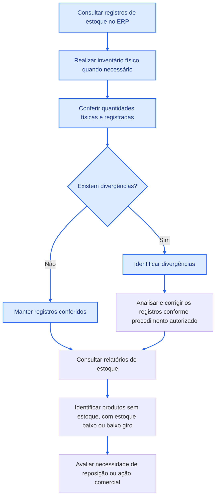

#### Processo 3 — Cadastro de clientes

O cadastro de clientes permite manter informações de identificação e contato utilizadas nas operações comerciais e no atendimento. Os dados são consultados conforme a necessidade das atividades da empresa. No comércio eletrônico, o tratamento dessas informações deve respeitar as regras aplicáveis de privacidade e proteção de dados pessoais, incluindo a Lei Geral de Proteção de Dados Pessoais (LGPD).

**Fluxograma:**

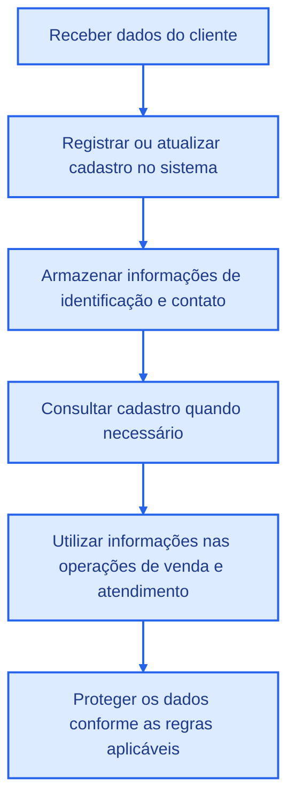

#### Processo 4 — Registro de vendas no PDV e no site

As vendas são realizadas por dois canais principais: o Ponto de Venda (PDV), nas lojas físicas, e o site, no comércio eletrônico. As informações comerciais registradas incluem os itens vendidos, as quantidades, os valores, os descontos e as formas de pagamento, além dos demais dados associados à operação. O registro dessas informações permite acompanhar as vendas realizadas nos diferentes canais.

**Fluxograma:**

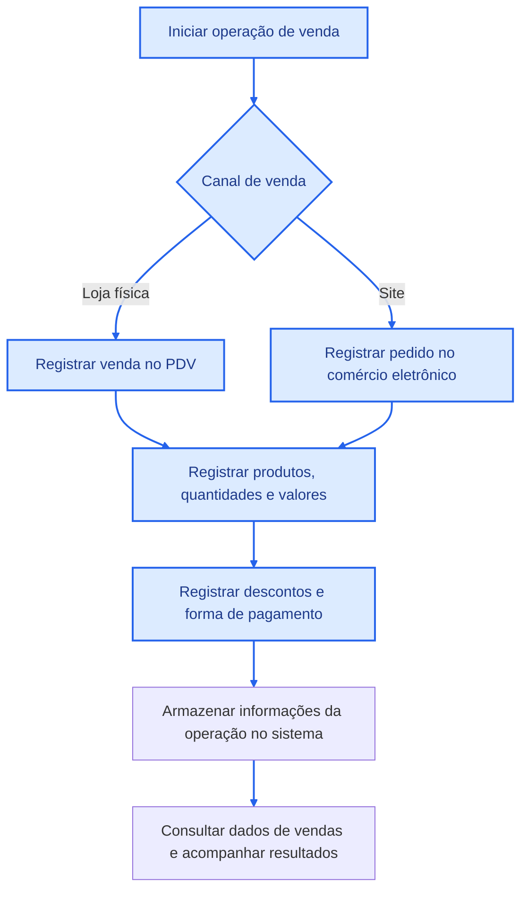

#### Processo 5 — Processamento de pedidos online

Os pedidos realizados pelo site passam por etapas de aprovação do pagamento, separação dos produtos, conferência por bipagem, faturamento, expedição e entrega. O acompanhamento do rastreamento permite consultar o andamento do envio. Também podem ocorrer cancelamentos e solicitações de reembolso, conforme a situação do pedido e os procedimentos aplicáveis.

**Fluxograma:**

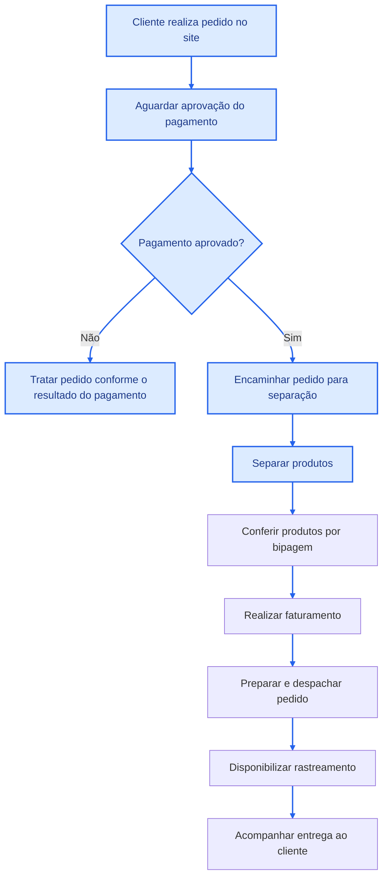

#### Processo 6 — Controle de preços e promoções

A empresa trabalha com diferentes condições de preços de acordo com o canal de venda e o tipo de cliente. As tabelas de preços são utilizadas para orientar a comercialização dos produtos. Alterações comerciais e descontos adicionais devem respeitar as autorizações estabelecidas pela diretoria. O histórico de preços pode auxiliar no acompanhamento das alterações realizadas.

**Fluxograma:**

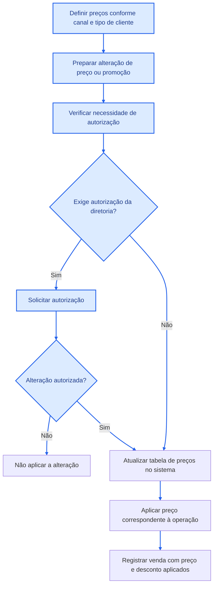

#### Processo 7 — Trocas, devoluções, cancelamentos e estornos

As solicitações de troca, devolução ou cancelamento exigem a identificação da operação e o tratamento correspondente. Nos casos de troca e devolução, o produto recebido deve passar por conferência antes da conclusão do procedimento. Quando aplicável, o processo pode envolver logística reversa, substituição do produto, cancelamento da venda ou solicitação de reembolso e estorno. Os critérios específicos devem seguir as regras adotadas pela empresa.

**Fluxograma:**

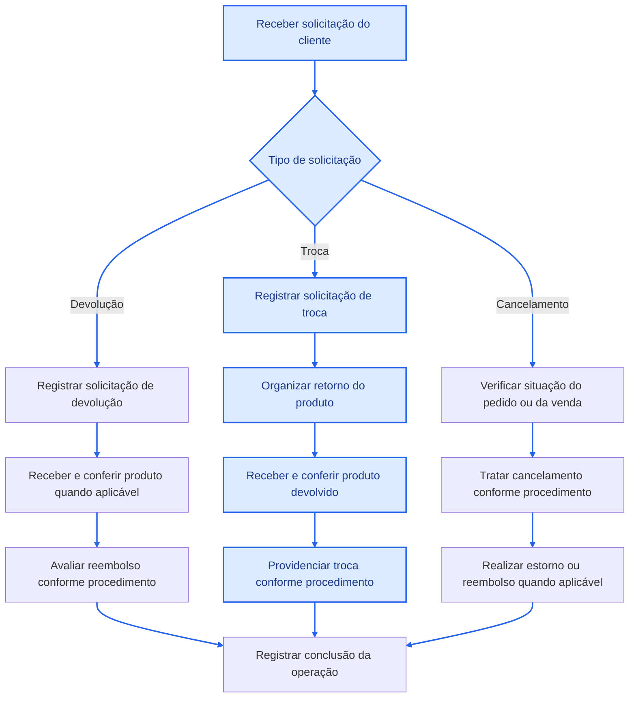

#### Processo 8 — Venda no atacado (condições B2B)

A empresa atende clientes de diferentes perfis, incluindo operações de varejo e atacado. As condições comerciais podem variar de acordo com o tipo de cliente, incluindo preços e descontos aplicáveis. O registro correto dessas condições permite distinguir as operações B2B (empresa para empresa) das operações B2C (empresa para consumidor final). Os valores mínimos de pedido, as quantidades mínimas e as regras específicas de aprovação ainda precisam ser confirmados com a empresa.

**Fluxograma:**

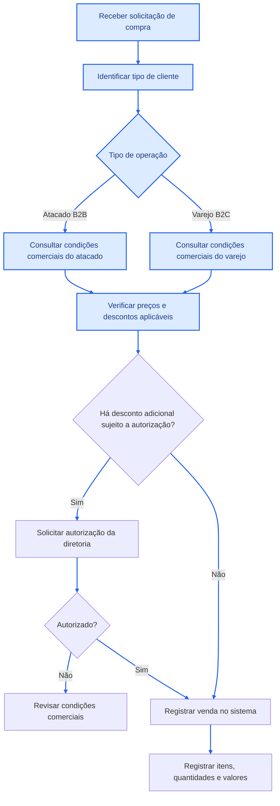

#### Processo 9 — Cadastro de fornecedores e marcas

O cadastro de fornecedores e marcas permite organizar as informações comerciais utilizadas nas compras e nas reposições de produtos. Os dados cadastrais dos fornecedores podem incluir CNPJ, razão social e nome fantasia. As informações das marcas são mantidas para facilitar a identificação dos produtos e o relacionamento comercial. A associação entre fornecedores e marcas deve refletir os vínculos efetivamente existentes na empresa.

**Fluxograma:**

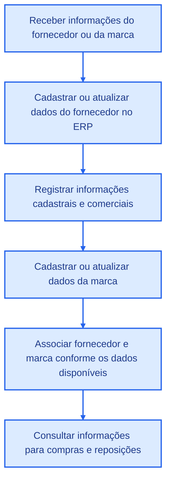

#### Processo 10 — Pedido de reposição a fornecedores

A reposição de produtos envolve a identificação das necessidades de compra, a definição dos produtos e das variações desejadas e o contato com os fornecedores. Os pedidos devem conter as informações necessárias para identificar os itens solicitados e acompanhar a entrega. Os fornecedores normalmente informam os prazos previstos para disponibilização das mercadorias, permitindo acompanhar o andamento das compras.

**Fluxograma:**

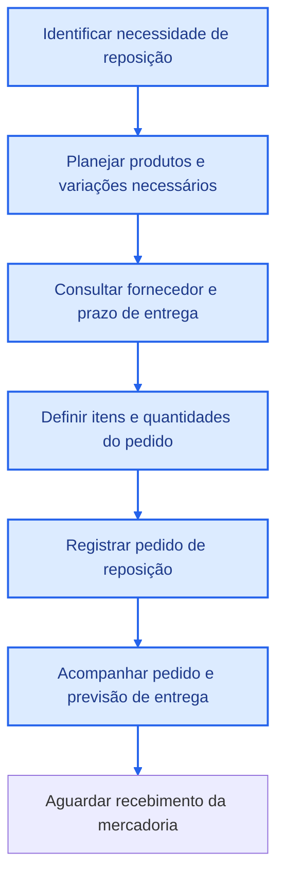

#### Processo 11 — Recebimento e conferência de mercadoria

O processo de recebimento começa após a entrega dos produtos pelo fornecedor, conforme o pedido de reposição realizado. A mercadoria deve ser conferida com base nas informações do pedido e nos documentos fiscais, verificando se os produtos, as quantidades e as variações recebidas correspondem ao solicitado. Após a conferência, as informações devem ser registradas no sistema e o estoque atualizado. Caso existam divergências, como quantidades incorretas ou produtos danificados, a ocorrência deve ser identificada para análise e resolução pelo setor responsável.

**Observação:** o fluxo abaixo representa uma proposta de processo. As etapas exatas de conferência, registro e tratamento de divergências precisam ser confirmadas com a empresa.

**Fluxograma:**

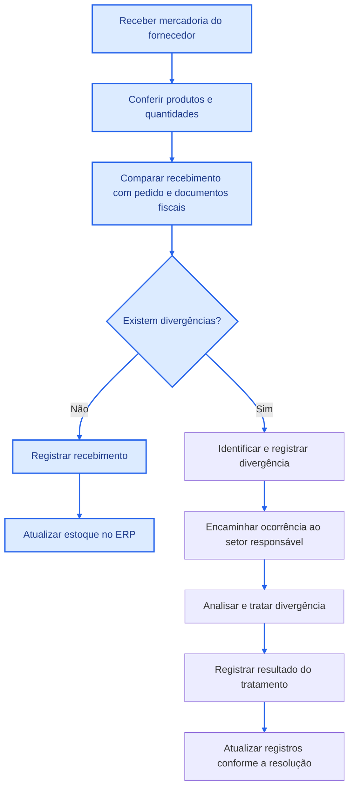

#### Processo 12 — Contas a pagar

O processo de contas a pagar envolve o controle dos compromissos financeiros da empresa, incluindo valores devidos aos fornecedores em decorrência das compras realizadas. As informações sobre pedidos, documentos fiscais, valores e vencimentos devem ser utilizadas pelo setor financeiro para acompanhar as obrigações e organizar os pagamentos. Após a realização de um pagamento, sua situação deve ser atualizada nos controles financeiros da empresa.

**Observação:** o fluxo abaixo é uma proposta para documentar o processo de negócio. A entrevista disponível não detalha o sistema utilizado para contas a pagar, as etapas de aprovação ou a forma de baixa dos pagamentos.

**Fluxograma:**

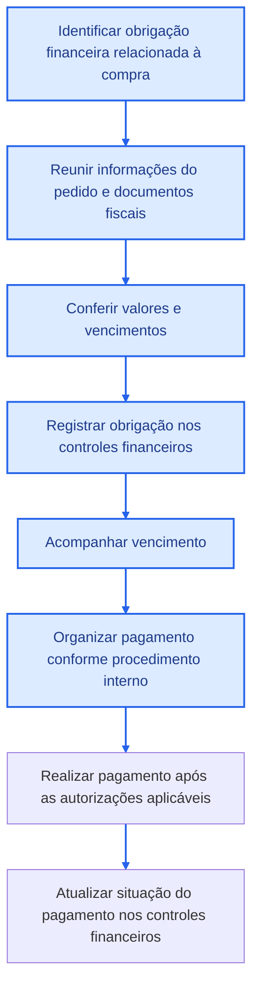

#### Processo 13 — Logística e centro de distribuição

O estoque destinado ao comércio eletrônico fica junto ao estoque central, no prédio da unidade da 25 de Março. A logística dos pedidos online envolve a localização e separação dos produtos, a conferência por bipagem, o encaminhamento para faturamento e a preparação para expedição. Após o despacho, o rastreamento permite acompanhar o envio até a entrega. Esse processo está relacionado ao processamento de pedidos online e ao controle de estoque.

**Fluxograma:**

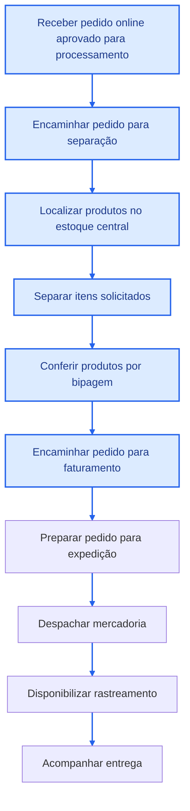

#### Processo 14 — Controle de usuários e permissões de acesso

Os funcionários acessam o ERP por meio de logins individuais e permissões hierárquicas relacionadas às responsabilidades de cada departamento. Essa organização permite restringir o acesso às funcionalidades de acordo com as atribuições dos usuários. A gestão de acessos contribui para a segurança das informações e para a utilização adequada do sistema.

**Fluxograma:**

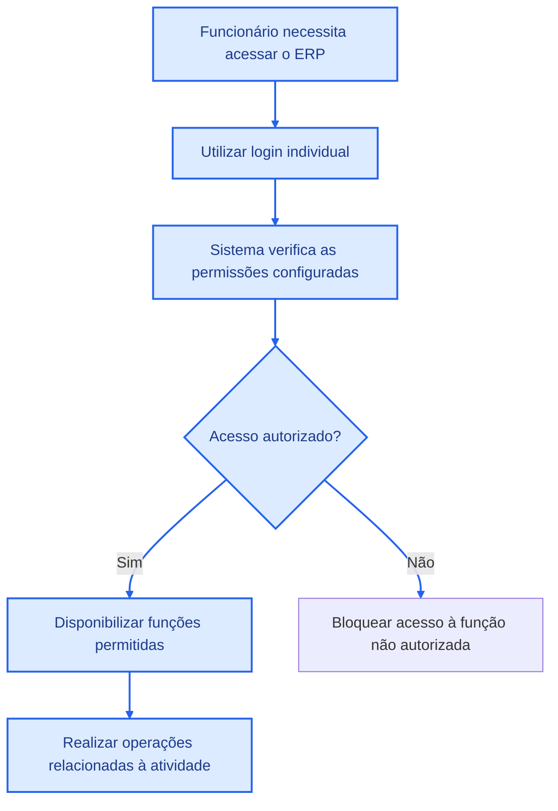

---

### 4.3. Processo Complementar — Geração de Relatórios

A geração de relatórios permite consultar informações sobre produtos, estoque, vendas, marcas e períodos. Esses dados auxiliam o acompanhamento das operações e apoiam decisões relacionadas à reposição de mercadorias, ao desempenho comercial e à gestão da empresa. A disponibilidade dos relatórios depende das informações registradas no ERP e das funcionalidades oferecidas pelo sistema.

**Fluxograma:**

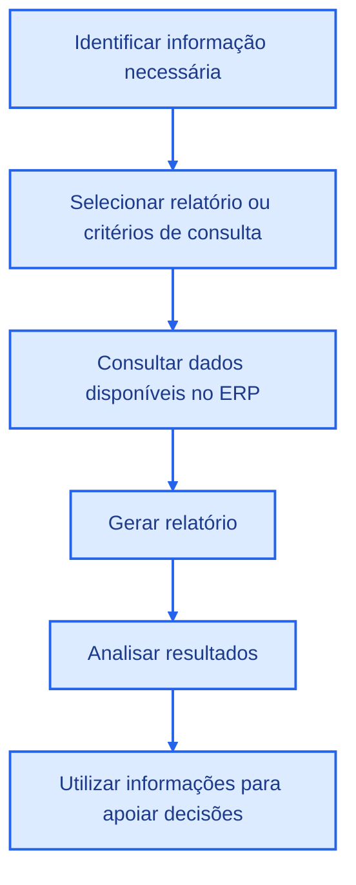

---

### 4.4. Integração entre os Processos de Negócio

Os processos de negócio estão relacionados e compartilham informações utilizadas em diferentes etapas da operação. O cadastro de produtos e suas variações fornece os dados necessários para as vendas e o controle de estoque. As vendas realizadas no PDV e no site se relacionam à disponibilidade dos produtos, enquanto os pedidos online dependem das atividades de separação, conferência, faturamento e expedição.

O processo de reposição também está relacionado ao estoque, pois a necessidade de compra pode ser identificada a partir das informações de disponibilidade e demanda. Após o recebimento e a conferência das mercadorias, os registros de estoque podem ser atualizados conforme o resultado da operação. As compras, por sua vez, geram compromissos financeiros que podem ser acompanhados pelo processo de contas a pagar.

As informações registradas no ERP alimentam relatórios que apoiam o acompanhamento das atividades. O controle de usuários e permissões atua de forma transversal, restringindo o acesso às funcionalidades conforme as responsabilidades de cada funcionário.

**Fluxograma da integração:**

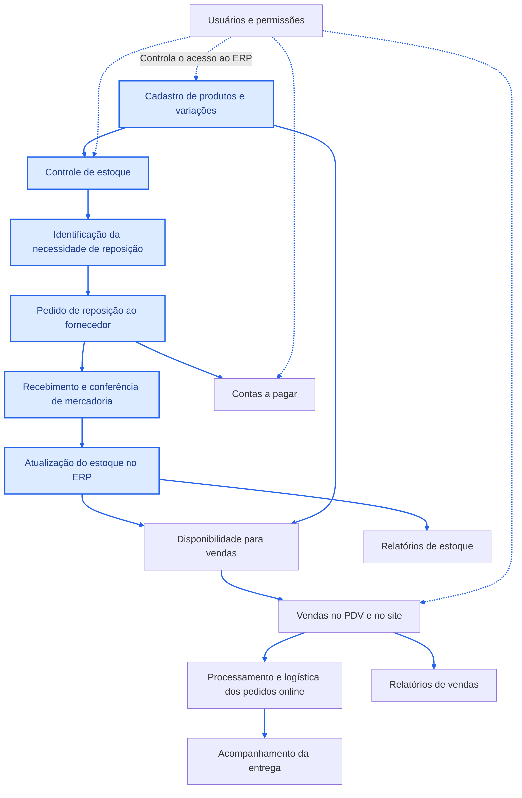

**Nota sobre a modelagem:** os fluxogramas representam os processos identificados no levantamento e, quando indicado, propostas preliminares para complementar a documentação. As etapas operacionais que não foram detalhadas na entrevista, especialmente as relacionadas ao recebimento de mercadorias, às divergências e às contas a pagar, devem ser validadas com a empresa antes de serem consideradas uma representação definitiva de seu funcionamento.

<br>

---

## 5. Requisitos do Sistema
Os requisitos do sistema foram organizados em *Requisitos Funcionais (RF)* e *Requisitos Não Funcionais (RNF) *. Os Requisitos Funcionais representam as funcionalidades e operações que o sistema deve realizar, enquanto os Requisitos Não Funcionais representam características, restrições e condições relacionadas ao funcionamento do sistema, como segurança, desempenho, disponibilidade e recuperação dos dados.<br>


<h4>Requisitos Funcionais</h4>

| Código | Requisito |
|---|---|
| RF01 | O sistema deve permitir cadastrar produtos informando código, descrição, referência, coleção, subcoleção, grupo, categoria, tipo e demais informações de cadastro utilizadas pela organização. |
| RF02 | O sistema deve permitir atualizar os dados cadastrais dos produtos, incluindo descrição, referência, coleção, subcoleção, grupo, categoria, tipo e informações fiscais. |
| RF03 | O sistema deve permitir cadastrar marcas e associá-las aos respectivos produtos. |
| RF04 | O sistema deve permitir cadastrar fornecedores, armazenando CNPJ, razão social e nome do fornecedor. |
| RF05 | O sistema deve permitir registrar pedidos de reposição vinculados a fornecedores e contendo os produtos/variações, quantidades e preços solicitados. |
| RF06 | O sistema deve permitir cadastrar clientes com seus dados de identificação e contato. |
| RF07 | O sistema deve permitir consultar o histórico de compras de um cliente a partir das vendas registradas. |
| RF08 | O sistema deve permitir registrar vendas contendo data, canal de venda, forma de pagamento, desconto, funcionário responsável e itens comercializados. |
| RF09 | O sistema deve permitir registrar, para cada item de venda, a quantidade, o preço unitário, o desconto e a variação do produto comercializada. |
| RF10 | O sistema deve permitir cadastrar e relacionar as variações dos produtos às respectivas cores e tamanhos. |
| RF11 | O sistema deve permitir controlar as quantidades disponíveis dos produtos/variações comercializados pela organização. |
| RF12 | O sistema deve permitir cadastrar tabelas de preços conforme o canal de venda e o tipo de cliente. |
| RF13 | O sistema deve permitir registrar o histórico dos preços aplicados às variações dos produtos, incluindo o preço e o período de vigência. |
| RF14 | O sistema deve permitir registrar pedidos realizados pelo site, incluindo data, status do pedido, status do pagamento, rastreamento, envio e entrega. |
| RF15 |O sistema deve permitir relacionar o pedido online à venda correspondente. |
| RF16 | O sistema deve permitir acompanhar as etapas do pedido online, incluindo pagamento, separação, conferência, faturamento, envio, rastreamento e entrega. |
| RF17 | O sistema deve permitir registrar ocorrências de troca, devolução e cancelamento relacionadas aos pedidos online, incluindo motivo, data, status e valor de estorno quando aplicável. |
| RF18 | O sistema deve permitir gerar relatórios de faturamento, estoque, produtos, marcas, clientes, categorias e comparativos de vendas. |
| RF19 | O sistema deve permitir controlar usuários e suas permissões de acesso de acordo com o departamento e a função exercida. |
| RF20 | O sistema deve permitir realizar backups das informações armazenadas e recuperar os dados a partir de uma cópia de segurança quando necessário. |
 <br>
 
<h4>Requisitos Não Funcionais</h4>

| Requisito | Descrição |
|---|---|
| RNF01 — Segurança | O sistema deve proteger os dados armazenados contra acessos não autorizados. |
| RNF02 — Privacidade | Os dados pessoais dos clientes devem ser tratados de acordo com a LGPD. (Lei Geral de Proteção de Dados Pessoais) |
| RNF03 — Controle de acesso | O sistema deve permitir restringir o acesso às informações conforme o departamento e as permissões atribuídas a cada funcionário. |
| RNF04 — Backup | O sistema deve realizar cópias de segurança periódicas dos dados armazenados. |
| RNF05 — Recuperação de dados | O sistema deve permitir recuperar informações a partir de backups em caso de perda ou inconsistência dos dados. |
| RNF06 — Integridade dos dados | O sistema deve utilizar mecanismos que reduzam a ocorrência de registros duplicados, inconsistentes ou desatualizados. |
| RNF07 — Usabilidade | O sistema deve facilitar o preenchimento, consulta e atualização das informações, principalmente durante o cadastro manual de produtos. |
| RNF08 — Compatibilidade | O sistema deve ser acessível por computadores e notebooks, dispositivos utilizados atualmente pela organização. |
| RNF09 — Desempenho | O sistema deve apresentar tempo de resposta adequado para consultas, registros e geração dos relatórios utilizados na rotina da organização. |


---

## 6. Regras de Negócio

As regras de negócio foram definidas a partir das informações obtidas durante o levantamento realizado com a representante da Ansarah.

<h4>Regras operacionais</h4>

| Código | Regra operacional | Descrição |
|---|---|---|
| RN01 | Cadastro de produtos | O cadastro de produtos é realizado no sistema de gestão empresarial utilizando informações fornecidas pelas fábricas. |
| RN02 | Informações dos produtos | Os produtos possuem informações relacionadas a características como referência, coleção, subcoleção, grupo, categoria, tipo, marca, cor e tamanho. |
| RN03 | Variações de produtos | As variações dos produtos são representadas por meio da entidade PRODUTO_SKU, permitindo relacionar cada produto às respectivas características de cor e tamanho. |
| RN04 | Registro de vendas | As vendas realizadas pela organização devem ser registradas no sistema e relacionadas aos produtos/variações comercializados. |
| RN05 | Produtos da venda | Cada PRODUTO_SKU relacionado à venda identifica a variação do produto comercializada. |
| RN06 | Pedidos online | Os pedidos online devem registrar informações referentes ao pagamento, separação, conferência, faturamento, envio, rastreamento e entrega. |
| RN07 | Trocas e devoluções | As trocas e devoluções devem passar pelo processo de conferência do produto antes da conclusão da operação. |
| RN08 | Cancelamentos | O cancelamento de um pedido pode ocorrer antes do envio, seguindo o processo definido pela organização para o estorno do pagamento. |
| RN09 | Proteção de dados dos clientes | As informações dos clientes utilizadas nas vendas online devem ser protegidas de acordo com as regras de privacidade aplicáveis. |
| RN10 | Histórico de preços | Os preços aplicados aos produtos devem ser registrados de acordo com as tabelas de preços utilizadas pela organização e seu respectivo período de vigência. |

<br>
<h4>Regras Organizacionais</h4>

| Código | Regra operacional | Descrição |
|---|---|---|
| RN10 | Prazos de troca | Os prazos e condições para trocas devem seguir as disposições aplicáveis do Código de Defesa do Consumidor. |
| RN11 | Condições B2C e B2B | As condições comerciais para clientes B2C e B2B podem apresentar diferentes prazos de pagamento, descontos e demais condições comerciais. |
| RN12 | Alteração de preços | A alteração de preços e a concessão de descontos dependem de autorização da diretoria. |
| RN13 | Permissões de acesso | O acesso às informações do sistema deve respeitar as permissões atribuídas aos funcionários conforme seus departamentos e funções. |
| RN14 | Proteção dos dados pessoais | As informações pessoais dos clientes devem ser tratadas de acordo com as regras estabelecidas pela LGPD. |
| RN15 | Reposição de produtos | Os pedidos de reposição devem ser associados a um fornecedor e devem informar as variações dos produtos, quantidades e preços solicitados. |


---

## 7. Modelo Conceitual (Entidade-Relacionamento-Atributos)

*A partir do levantamento realizado com a organização, foram identificadas as seguintes entidades principais:*
<br><br>
•**Cliente:** representa os clientes cadastrados pela organização.
<br>
•**Funcionário:**. representa os funcionários envolvidos nos processos da organização.
<br>
•	**Departamento:** representa os setores responsáveis pelas atividades da empresa. 
<br>
•**Produto:** representa os produtos comercializados pela organização. 
<br>
•**Produto_SKU:** representa as variações específicas dos produtos, associadas às características de cor e tamanho.
<br>
•	**Marca:** representa as marcas comercializadas pela organização. 
<br> 
•**Fornecedor:** representa os fornecedores cadastrados no sistema.
<br> 
•	**Cor:** representa as cores utilizadas nas variações dos produtos.
<br> 
•	**Tamanho:** representa os tamanhos utilizados nas variações dos produtos. 
<br> 
•**Venda:** representa as vendas realizadas pela organização.
<br> 
•**Pedido_Online:** representa os pedidos realizados pelo site. 
<br> 
•**Tabela_Preco:** representa as diferentes tabelas de preços utilizadas pela organização. 
<br> 
•	**Historico_Preco:** registra os preços aplicados às variações dos produtos ao longo do tempo.
<br> 
•	**Troca_Devolucao:** representa ocorrências de troca, devolução ou cancelamento relacionadas aos pedidos online. 
<br> 
•**Pedido_Reposicao:** representa os pedidos realizados aos fornecedores para reposição de produtos. 
<br><br>

<h4>Atributos e classificações:</h4>

Os atributos foram definidos a partir das informações obtidas durante a entrevista e representam os dados necessários para caracterizar as entidades e registrar os processos da organização.
<br>
A entidade **Produto** concentra as informações gerais de cadastro, como código, descrição, referência, coleção, subcoleção, grupo, categoria, tipo e informações fiscais.
<br><br>
A entidade **Produto_SKU** representa uma variação específica do produto, permitindo associar características como cor e tamanho sem repetir os dados gerais do produto.
<br><br>
A entidade **Venda** registra as informações gerais das vendas realizadas e mantém o relacionamento direto com os produtos/variações comercializados.
<br><br>
A entidade **Pedidos_Online** possuem informações próprias do processo de venda pelo site, como status do pedido, status do pagamento, rastreamento, envio e entrega. A venda correspondente é registrada na entidade Venda, que está relacionada aos SKUs dos produtos comercializados.
<br><br>
A entidade **Historico_Preco** armazena o preço aplicado à variação do produto, sua tabela de preço e o período de vigência, permitindo manter o histórico das alterações de preço.
<br><br>
A entidade **Pedido_Reposicao** registra as solicitações realizadas aos fornecedores e mantém relacionamento direto com os produtos/variações que precisam ser repostos.

<h4>Relacionamentos pertinentes</h4>

**Os relacionamentos identificados no modelo são:**  
<br>
• Departamento possui Funcionários; <br>
• Marca possui Produtos; <br>
• Produto possui Produto_SKU; <br>
• Cor possui Produto_SKU; <br>
• Tamanho possui Produto_SKU; <br>
• Cliente está associado às Vendas; <br>
• Funcionário registra Vendas; <br>
• Venda possui Produto_SKU; <br>
• Cliente realiza Pedidos_Online; <br>
• Pedido_Online gera a Venda correspondente; <br>
• Tabela_Preco possui registros de Historico_Preco; <br>
• Produto_SKU possui registros de Historico_Preco; <br>
• Pedido_Online possui ocorrências de Troca_Devolucao; <br>
• Fornecedor recebe Pedidos_Reposicao; <br>
• Pedido_Reposicao possui Produto_SKU; <br>


**As cardinalidades são representadas no DER conforme as relações identificadas no levantamento.**

---

### 8. DER Diagrama Entidade-Relacionamento 

O **Diagrama Entidade-Relacionamento (DER)** está **anexado no repositório**.

> **Imagem do DER: anexada no repositório.**

---

## 9. Dicionário de Dados

O **Dicionário de Dados** está **anexado no repositório**.

Ele apresenta as entidades, atributos, chaves primárias (PK), chaves estrangeiras (FK) e demais informações definidas para o modelo.

> **Arquivo do Dicionário de Dados: anexado no repositório.**

---

## 10. Justificativa Técnica do Modelo
<br>
A modelagem conceitual foi desenvolvida com o objetivo de organizar as informações da Ansarah de forma estruturada, representando as principais entidades envolvidas nos processos de cadastro, vendas, estoque, preços, pedidos online, reposição e atendimento de ocorrências.<br>

A entidade **Produto** concentra as informações gerais dos produtos comercializados pela organização, como código, descrição, referência, coleção, subcoleção, grupo, categoria, tipo e informações fiscais. O preço não foi mantido diretamente nessa entidade, pois a organização trabalha com diferentes tabelas de preços e realiza alterações de valores ao longo do tempo.<br>

A entidade **Produto_SKU** foi utilizada para representar as variações específicas dos produtos, permitindo relacioná-las às características de cor e tamanho. Essa estrutura evita a repetição das informações gerais armazenadas em Produto.<br>
As entidades **Cor e Tamanho** foram separadas para permitir que essas características sejam reutilizadas em diferentes variações de produtos.<br>

A entidade **Venda** representa as vendas realizadas pela organização e mantém relacionamento direto com Produto_SKU, permitindo identificar os produtos/variações comercializados em cada venda.<br>

A entidade **Pedido_Online** representa as informações específicas dos pedidos realizados pelo site, como status, pagamento, rastreamento, envio e entrega. Como a organização utiliza os mesmos registros de itens para representar os produtos comercializados, o pedido online é associado à venda correspondente.<br>

Da mesma forma, a entidade **Pedido_Reposicao** mantém relacionamento direto com Produto_SKU, permitindo representar os produtos/variações solicitados aos fornecedores para reposição.<br>

A entidade **Tabela_Preco** foi criada para representar as diferentes tabelas de preços utilizadas pela organização, considerando características como canal de venda e tipo de cliente. A entidade **Historico_Preco** registra os valores aplicados aos produtos ao longo do tempo, permitindo identificar o preço utilizado em determinado período.<br>

As entidades **Fornecedor** e **Pedido_Reposicao** representam o processo de reposição de produtos. O **Pedido_Reposicao** registra a solicitação realizada junto ao fornecedor e está relacionado ao **Produto_SKU**, identificando a variação do produto que será reposta.<br>

A entidade **Troca_Devolucao** registra ocorrências relacionadas aos pedidos online, como trocas, devoluções e cancelamentos, permitindo armazenar informações como motivo, data, status e valor de estorno quando aplicável.<br>

A entidade **Funcionario** foi relacionada à entidade **Departamento**, permitindo representar a distribuição dos funcionários pelos diferentes setores da organização. A entidade Cliente permite relacionar os clientes às vendas e aos pedidos online realizados.<br>
As chaves primárias (PK) identificam exclusivamente os registros de cada entidade. As chaves estrangeiras (FK), presentes no dicionário como referência para uma futura implementação relacional, representam as ligações entre as entidades. No modelo conceitual, essas ligações são representadas principalmente por meio dos relacionamentos e suas respectivas cardinalidades.<br>

A estrutura proposta busca reduzir a duplicidade de informações, organizar os dados de acordo com os processos identificados na organização e permitir futuras expansões do sistema.
<br><br>


---

## 11. Uso de Inteligência Artificial
| Item | Registro |
|---|---|
| Ferramenta e etapa | ChatGPT — elaboração do questionário para levantamento de requisitos e estruturação/ organização do README |
| Motivação | Auxiliar o grupo na elaboração das perguntas para a entrevista, e na organização das informações obtidas |
| Prompt(s) utilizados | Levantamento de requisitos: “Estamos realizando um trabalho de Banco de Dados no qual precisamos entrevistar uma organização de pequeno porte e levantar requisitos para desenvolver um modelo conceitual. A organização é uma loja de roupas. Crie perguntas que nos ajudem a entender os processos, dados utilizados, estoque, vendas, clientes, fornecedores, funcionários, relatórios, segurança e dificuldades do sistema. <br><br> Organização do trabalho: “Com base nas informações obtidas na entrevista com a Ansarah, explique como o conteúdo do trabalho deve ser organizado de acordo com o roteiro do professor. Explique também quais informações devem ser apresentadas no, Processos de Negócio, Requisitos Funcionais, Requisitos Não Funcionais, Regras de Negócio e como deverá ser feito o Dicionário de Dados." |
| Resposta recebida | A IA sugeriu perguntas sobre produtos, estoque, vendas, clientes, fornecedores, pedidos, relatórios, segurança e processos internos. Também auxiliou na organização das informações nas seções do trabalho e sugeriu entidades, atributos, relacionamentos e cardinalidades preliminares para o MER/DER. |
| Fontes consultadas e verificadas | As informações sobre a organização foram obtidas por meio da entrevista com a representante da Ansarah e complementadas por pesquisas em fontes públicas, como consulta de CNPJ e perfil da empresa no LinkedIn. O conteúdo também foi confrontado com o roteiro disponibilizado pelo professor. As sugestões da IA foram utilizadas apenas como apoio e não como fonte de informações sobre a empresa. |
| Trechos rejeitados ou corrigidos | Algumas perguntas, informações, regras e trechos sugeridos pela IA foram retirados, reformulados ou corrigidos por não serem relevantes ou por não terem sido confirmados pela organização. |
| Justificativa da escolha final | A versão final será definida pelo grupo com base na pesquisa de campo e nas orientações da disciplina. |
| Reflexão crítica | A IA foi utilizada como ferramenta de apoio, organização e escrita, mas suas sugestões não foram consideradas como informações definitivas sobre a empresa. As respostas da entrevista e as decisões do grupo foram utilizadas para validar e adaptar o conteúdo. |

<br><br>
---

## 12. Conclusão
A pesquisa realizada com a Ansarah, por meio de perguntas direcionadas à organização, possibilitou compreender os principais processos relacionados ao gerenciamento de suas informações. Foram identificadas atividades envolvendo produtos, variações de produtos, estoque, clientes, funcionários, departamentos, vendas, fornecedores, marcas, preços, pedidos online, pedidos de reposição, trocas, devoluções, relatórios e controle de acesso.<br><br>
A principal dificuldade identificada está relacionada à inserção manual das informações, especialmente no cadastro de produtos, além da customização de relatórios e da necessidade de correções ou recuperação de dados em determinadas situações.<br><br>
Com base nessas informações, foi elaborada uma proposta de modelo conceitual que organiza as principais entidades, atributos e relacionamentos identificados durante o levantamento. O modelo considera também as variações dos produtos por meio da entidade Produto_SKU, além dos processos relacionados a vendas, pedidos online, estoque, controle de preços e reposição de produtos.<br><br>
O modelo conceitual será validado e refinado conforme novas informações sejam obtidas junto à organização. Após sua validação, ele servirá como base para as próximas etapas do projeto, incluindo a elaboração do modelo lógico, a implementação em SQL e o desenvolvimento de consultas ao banco de dados.
<br><br>


---

## 13. Referências

- **ANSARAH.** Informações institucionais e comerciais.  
  https://www.ansarah.com.br/

- **ANSARAH.** Entrevista e questionário com representante da organização. 2026.

- **Google Maps.** Localização das lojas da Ansarah.  
  25 de Março: https://maps.app.goo.gl/ja89dX2NqaD3WHnK6  
  Brás: https://maps.app.goo.gl/SKGrzBL6uDV7w4WL8

- **CNPJ.BIZ.** Consulta de registro da organização.  
  > **(https://cnpj.biz/61419610000119)**

---

